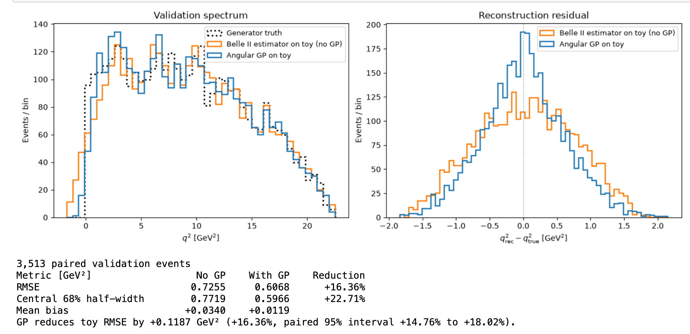

# Belle-BtoKnunu

**Improving inclusive-tag q² reconstruction in B⁺ → K⁺νν̄**

Can the visible recoil tell us enough about the signal B direction to improve the reconstructed mass squared of the neutrino pair? In this signal-only toy, a sparse Gaussian process (GP) reduced the event-by-event q² root-mean-square error by **16.36%** relative to the Belle II inclusive-tag estimator applied to the same 3,513 validation events. The central 68% of residuals also narrowed.

## Follow the analysis from the beginning

| Stage | Start here | Output |
|---|---|---|
| Kinematic baseline | [First notebook](notebooks/01_kinematic_baseline.ipynb) | Ideal-kinematics checks of the stationary-B approximation |
| Signal decay | [RapidSim build, cards and validation](rapidsim/README.md) | 100,000 unsmeared B⁺ → K⁺νₑν̄ₑ decays with the KNUNU amplitude |
| Charged B pair | [EvtGen driver](simulation/BPairGenerator.cc), [forced decay table](simulation/signal.dec) | 20,000 Υ(4S) → B⁺B⁻ events with a generic tag-side decay |
| Reconstruction | [Object response](simulation/response.json), [feature exporter](simulation/export_features.py) | 17,948 retained signal kaons and 11 reconstructed inputs |
| Regression and validation | [CERN SWAN notebook](SWAN_trainable11.ipynb), [paired evaluation](evaluate.py) | A fitted angular GP, validation predictions and a q² comparison |

The first notebook and the RapidSim tree are independent checks of the signal kinematics. The training dataset starts from the **charged-pair event record**. The companion B produces the visible recoil that lets the GP infer the signal direction. For the main GPU fit you can open the SWAN notebook immediately using the included feature table.

### Generate and reconstruct

Run the following from the repository root with Git, Bash and Pixi. The bootstrap creates a dedicated RapidSim checkout and a pinned simulation environment under `vendor/RapidSim`. It supports Linux x86-64 and Apple Silicon. The GP runs in its own Python environment.

```bash
# 1. Signal-only check
bash rapidsim/setup.sh
bash rapidsim/generate.sh 100000 runs/rapidsim_signal

# Reuse this environment for ROOT, EvtGen, Pythia and the C++ compiler
sim() { pixi run --manifest-path vendor/RapidSim/pixi.toml --frozen -- "$@"; }
sim python rapidsim/validate_signal.py runs/rapidsim_signal/BToKnunu_tree.root

# 2. Generate a charged pair and check the full decay record
sim cmake -S simulation -B build/bpair -GNinja
sim cmake --build build/bpair
sim build/bpair/BPairGenerator.exe --events 20000 --seed 1776 --output runs/bpair.root
sim python simulation/validate_bpair.py --input runs/bpair.root --outdir runs/bpair_validation

# 3. Apply the nominal response and write the 11 inputs, truth labels and split IDs
sim python simulation/export_features.py runs/bpair.root runs/regenerated.npz
sim python simulation/test_response.py
```

The full-pair validation checks the signal q² and B production-angle distributions, charge conservation, ancestry, four-momentum closure and hadronisation of the generic tag. [Generator validation results](results/bpair_validation_20k.json) · [Validation plots](results/bpair_validation.png)

To start at reconstruction, use `data/reference/bpair_20k.root` as the exporter input. The original [RapidSim tree](data/reference/BToKnunu_tree.root), [RapidSim histograms](data/reference/BToKnunu_hists.root) and [charged-pair tree](data/reference/bpair_20k.root) are included. In the nominal response, charged tracks must have transverse momentum ≥0.1 GeV and polar angle 17–150°. Photons must have energy ≥0.1 GeV and fall in an accepted calorimeter region within that angular range. Smearing, object efficiencies and gaps operate in the toy lab frame. Retained objects are boosted back to the CM for feature construction. The kaon is truth-designated and must survive the same charged-object response. [Response implementation](simulation/response.py) · [Numerical settings and sources](simulation/response.json)

## Validation result

| Metric (GeV²) | Belle II estimator on toy | Angular GP on toy |
|---|---:|---:|
| Root-mean-square error | 0.7255 | 0.6068 |
| Central 68% half-width | 0.7719 | 0.5966 |
| Mean reconstructed minus true q² | +0.0340 | +0.0119 |

The uncertainty interval for the **relative RMSE reduction** is **14.76–18.02%** from 2,500 paired event-bootstrap resamples. It describes validation-event variation for these fitted predictions. The central 68% half-width, defined as half the distance between the 16th and 84th percentiles, fell by **22.71%**. The plotted result comes from the completed CERN SWAN study. The repository includes the training sample, fitting and evaluation code and the recorded output figure. A fresh fit produces its own checkpoint and event-level predictions.



## What the GP learns

In the fixed-energy electron–positron centre-of-mass frame, the beam fixes the B energy and momentum magnitude. Inclusive tagging leaves its direction uncertain. Belle II approximates the B as stationary when constructing its kaon-energy estimator. In natural units,

$q^2_{\mathrm{ITA}}=s/4+m_K^2-\sqrt{s}\,E_K^*.$

The GP estimates the missing angular quantity from reconstructed event information. Its training label is the cosine between the generator-level signal B and kaon directions. For each prediction, the reconstructed kaon and the beam constraint give

$q^2_{\mathrm{GP}}=m_B^2+m_K^2-\sqrt{s}\,E_K^*+2|\mathbf p_B^*||\mathbf p_K^*|\,\widehat{\cos\theta_{BK}^*}.$

The first term uses the B mass shell, so the full difference between the estimators includes both a constant mass correction and the angular term. The published baseline is Eq. (2) of the Belle II analysis. [Belle II, Phys. Rev. D 109, 112006 (2024)](https://doi.org/10.1103/PhysRevD.109.112006)

### The 11 reconstructed inputs

| Object | Stored columns, in training order | Physical content |
|---|---|---|
| Kaon | `k_E_cm`, `k_cos_theta_cm` | CM energy and direction relative to the beam |
| Rest of event (ROE) | `roe_E_cm`, `roe_p_cm`, `roe_cos_k`, `roe_cos_theta_cm` | Total visible recoil energy, momentum magnitude and orientation relative to the kaon and beam |
| ROE composition | `roe_charge`, `roe_scalar_p_cm` | Net charge and sum of individual momentum magnitudes |
| Whole event | `event_missing_E_cm`, `event_missing_p_cm`, `event_missing_cos_theta_cm` | Missing energy, missing three-momentum magnitude and its polar-angle cosine |

The ROE excludes the signal-kaon candidate. Energies and three-momenta are in GeV. The truth label and true q² are stored separately from the feature matrix. The input and target scalers use training rows only.

## Train and evaluate the GP

**CERN SWAN GPU.** Open [SWAN_trainable11.ipynb](SWAN_trainable11.ipynb) from this directory in a GPU session. Run its cells in order. The first code cell sets the number of trainable inducing locations (default `M = 1000`). It can reuse a private SWAN Python workspace. The preflight checks float64 Cholesky placement and finite GPflow gradients. The fit writes a new directory under `runs/`. The inclusive-tag comparison reads its saved validation predictions.

**Linux CPU.** From this directory, use Python 3.12 and run:

```bash
python3.12 -m venv .venv
source .venv/bin/activate
python -m pip install -r requirements-cpu.txt
export TF_USE_LEGACY_KERAS=1 OPENBLAS_NUM_THREADS=1
python studies/inducing_scan/fit_validation.py \
  --input data/eleven.npz --outdir runs/cpu_M1000 \
  --inducing 1000 --train-inducing --device cpu
python evaluate.py runs/cpu_M1000
```

For a quick installation check, use a fresh output directory and add `--train-cap 128 --inducing 16 --maxiter 2 --validate-every 1` in place of the nominal inducing-count option. The evaluation command writes `paired_validation.png` and `paired_validation.json` into the run directory. For optional test scoring, use the final notebook cell after selecting the configuration. Numeric comparisons across hardware can depend on the optimization trajectory.

### Fit and sample

The nominal GP uses float64 GPflow SGPR with a Matérn-5/2 covariance and a separate length scale per input, additional linear and constant covariance terms, a linear mean, and a Gaussian likelihood. K-means initializes the inducing locations. L-BFGS-B learns their coordinates and the model parameters with a limit of 1,000 iterations. Training uses 5,000 events drawn from 10,842 training rows. Both training selection and initialization use seed 120. The checkpoint minimizes monitored validation q² RMSE over 3,513 events, evaluated at initialization, every 25 iterations and at the end. There are 3,593 test events. The reported result uses validation.

The toy contains 20,000 charged B pairs produced at a fixed CM energy of 10.58 GeV. A standalone EvtGen driver forces the signal decay using the KNUNU amplitude, generates a generic companion B decay, and invokes Pythia for partonic decay modes. The simplified response applies charged-track and photon acceptance, efficiency, smearing and thresholds. A truth-designated signal kaon survives in 17,948 events. The sample excludes continuum and physics backgrounds, beam-background occupancy and signal-candidate combinatorics. Measuring the impact on Belle II sensitivity requires realistic event selection and migration modelling in the likelihood.

### Train on your own export

For a fit using the output of stage 3, change the CPU command's input to `--input runs/regenerated.npz`, choose a fresh fit directory, and pass the same input file to the evaluation script. For example, after fitting to `runs/from_generator`:

```bash
python evaluate.py runs/from_generator --input runs/regenerated.npz
```

The evaluator checks the dataset checksum against the saved fit, aligns the event IDs and verifies the inclusive-tag formula before computing the paired difference. Regenerating from the bundled charged-pair ROOT file reproduced all 17,948 reference rows, including the inputs, angular targets, true q², baseline estimates and split assignments.

### Development studies

[Model and reconstruction comparisons](results/development/README.md) cover the initial kaon-only estimate, adding recoil variables, alternative targets, inducing-point counts and the 11-versus-13-input check. The final SWAN model checkpoint and its individual predictions were unavailable for packaging. The reported figure records that run, and the notebook produces new predictions for a refit.

### Related code

The earlier [LHCb momentum reconstruction](https://github.com/HavvaHasretNur1776/GaussianProcessRegression) used a GP to help resolve the two momentum solutions in a single-neutrino decay. Here the learned quantity is the angular projection entering q². Simulation source credits are in [simulation/NOTICE.md](simulation/NOTICE.md).
